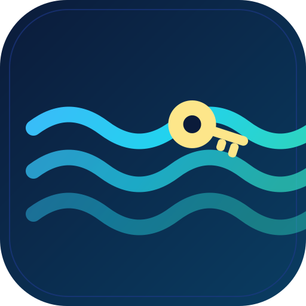

<div align="center">



# river-bulk-apikey

**Erstelle [River AI](https://console.river.ai)-Konten im Batch und generiere automatisch einen API-Key pro Konto — gesteuert über ein echtes Chrome/Chromium auf deinem Rechner oder VPS via CDP. Null Abhängigkeiten.**

[](../LICENSE)
[](https://nodejs.org)
[](#)
[](https://docs.river.ai/guides/inference)
[](#-mit-9router-verbinden)

[English](../README.md) · [Bahasa Indonesia](README.id.md) · [简体中文](README.zh.md) · [日本語](README.ja.md) · [Español](README.es.md) · [Deutsch](README.de.md)

</div>

---

## ✨ Funktionen

- 🔑 **Massenhaft Konten + API-Keys** — ein River-Konto *und* ein `rv_…`-Key pro Durchlauf.
- 🧼 **Vollständig isolierte Sitzungen** — jedes Konto läuft in einem eigenen CDP-Browserkontext; keine Cookie- oder `localStorage`-Leaks.
- 🪶 **Null Abhängigkeiten** — handgeschriebener RFC6455-WebSocket + CDP-Client. Kein `npm install`.
- 🤖 **Registrierung im echten Browser** — die gehostete AuthKit-Seite wird in echtem Chrome/Chromium auf deinem Rechner oder VPS gesteuert.
- 📧 **Wegwerf-Postfächer** — Bestätigungscodes direkt von [mail.tm](https://mail.tm).
- 📦 **Export** — Ergebnisse als JSON **und** CSV.
- 🔌 **9Router-Connector** — River-Keys mit einem Befehl als OpenAI-kompatiblen Provider in [9Router](https://9router.com) einbinden.
- 🌍 **6 Sprachen** — EN, ID, ZH, JA, ES, DE.

## 🚀 Schnellstart

```bash
# 1. Headless-Chrome mit Debug-Port starten (Rechner oder VPS)
google-chrome --headless=new --remote-debugging-port=9222 \
  --user-data-dir="$HOME/.river-chrome" --no-sandbox &

# 2. 3 Konten erstellen, jedes mit eigenem API-Key
node src/cli.js --count 3 --cdp-url http://127.0.0.1:9222

# Ergebnisse: outputs/river-accounts.json (+ .csv)
```

## 🧭 Funktionsweise

Die River-Konsole registriert Nutzer über einen **gehosteten Browser-Flow**
(WorkOS AuthKit), und ihre REST-API arbeitet mit Bearer-Tokens — eine
skriptbare HTTP-Registrierung gibt es also nicht. Daher steuert `river-bulk` die
echte gehostete UI im Browser, liest den Sitzungs-Token aus und spricht
anschließend mit der API der Konsole:

> **Hinweis:** Rivers Registrierung verlangt inzwischen eine Telefonverifizierung,
> sobald sie einige Anmeldungen gesehen hat; das Tool stoppt dann an diesem
> Schritt — registriere in kleinen Chargen.

```
mail.tm-Postfach ──▶ Signup-UI ──▶ E-Mail-Code ──▶ Konsole (Token erfasst)
                                                        │
                                            POST /api/keys { name }
                                                        ▼
                                                   rv_…  API-Key
```

Vollständige Details: [`docs/PROTOCOL.md`](../docs/PROTOCOL.md).

## 🖥️ Voraussetzungen — ein Chrome zum Steuern

`river-bulk` spricht mit jedem Chrome/Chromium, das über den **CDP-Debug-Port**
erreichbar ist. Dein Rechner oder ein VPS genügt — kein Cloud-Dienst nötig.

```bash
google-chrome --headless=new --remote-debugging-port=9222 \
  --user-data-dir="$HOME/.river-chrome" --no-sandbox &
```

| Flag / env | Wert | Hinweis |
| --- | --- | --- |
| `--cdp-url` / `CDP_URL` | `http://127.0.0.1:9222` | Löst `/json/version` automatisch auf. **Standard.** |
| `--cdp-ws` / `CDP_WS` | `ws://host:9222/devtools/browser/<id>` | Explizite WebSocket-URL. |

## 🧰 CLI-Referenz

```
node src/cli.js [Optionen]

  -n, --count <n>          Anzahl der Konten                     [1]
  -c, --concurrency <n>    parallele Konten (1 pro Browser)       [1]
      --cdp-url <url>      Chrome-Debug-HTTP-Endpunkt     [http://127.0.0.1:9222]
      --cdp-ws <url>       explizite CDP-WebSocket-URL
      --out <file>         JSON-Ausgabe      [outputs/river-accounts.json]
      --csv <file>         CSV-Ausgabe       (neben --out)
      --key-prefix <name>  Präfix des Key-Namens            [river-bulk]
      --quiet              Fortschritt unterdrücken
  -h, --help               Hilfe anzeigen
```

### Nutzung als Bibliothek

```js
const { CDP, provisionAccount, listModels } = require('./src/river');
const { MailTM } = require('./src/mailtm');

const cdp = new CDP('ws://127.0.0.1:9222/devtools/browser/<id>', {});
await cdp.connect();
await cdp.attachToPage();

const account = await provisionAccount(cdp, new MailTM(), { keyName: 'mein-key' });
console.log(account.email, account.apiKey, account.balanceUsd);
cdp.close();
```

## 🤖 Modelle & kostenloses Kontingent

| Modell-ID | Input | Gecachter Input | Output | Kontext | Max. Output |
| --- | ---: | ---: | ---: | ---: | ---: |
| `deepseek-ai/DeepSeek-V4.1-Flash` | $0.12 | $0.0024 | $0.48 | 1.048.576 | 384.000 |
| `zai-org/GLM-5.3-Flash` | $0.12 | $0.024 | $0.40 | 1.048.576 | 128K |

*Preise in USD pro Million Tokens. Beide unterstützen Text + Bild, Streaming, Reasoning und Function Calling.*

**Was ein neues Konto bekommt:** ein Guthaben von **$25** — das Tool liest `balanceUsd` für jedes
Konto und schreibt es in den JSON/CSV-Export (`"balanceUsd": 25`), das Guthaben ist also pro Key
sichtbar statt angenommen.

**Mehr Guthaben:** Das Guthaben liegt auf dem **Konto** — ein Konto pro Key, und ein neues Konto ist
ein neues Guthaben. `--count N` erstellt N Konten, jedes mit eigenem `rv_…`-Key.

Die aktuelle Modell- und Preisliste jederzeit prüfen: `GET https://api.river.ai/v1/models`.

```bash
curl https://api.river.ai/v1/chat/completions \
  -H "Authorization: Bearer $RIVER_API_KEY" -H "Content-Type: application/json" \
  -d '{"model":"zai-org/GLM-5.3-Flash","messages":[{"role":"user","content":"hallo"}]}'
```

## 🔌 Mit 9Router verbinden

```bash
node src/connect-9router.js \
  --base http://localhost:20128 --password 123456 \
  --api-key rv_xxxxxxxx
```

Modelle in 9Router:

```
river/zai-org/GLM-5.3-Flash
river/deepseek-ai/DeepSeek-V4.1-Flash
```

## ⚠️ Haftungsausschluss

Dieses Projekt dient **Bildungs- und Forschungszwecken**. Die automatisierte
Kontoerstellung kann gegen die Nutzungsbedingungen eines Anbieters verstoßen.
Die Nutzung erfolgt auf eigene Verantwortung.

## 📄 Lizenz

[MIT](../LICENSE) © 2026 river-bulk-apikey contributors
